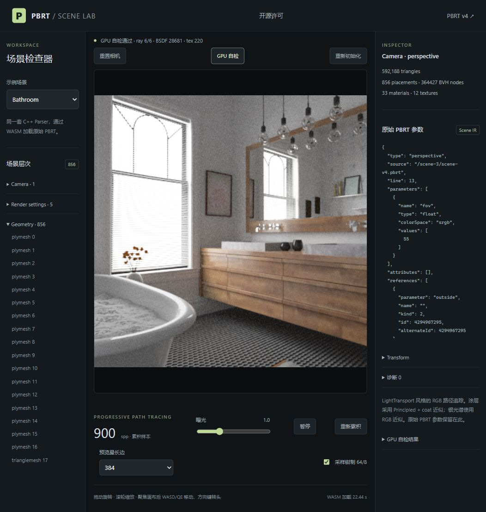

# pbrt-v4-parser

English | [简体中文](README.zh-CN.md)

An independent C++20 PBRT-v4 scene parsing SDK with **no dependencies beyond the standard library**. Load PBRT files into a renderer-independent Scene IR for CPU, CUDA, DXR, Vulkan, or WebGPU consumers. The core library does not depend on any rendering backend.

Currently a **0.1 development version**: the Parser, SceneBuilder, shared-instance IR, optional PLY/geometry utilities, CLI, and Tiny CPU Path Tracer are working. The single-threaded WASM consumer and WebGPU Scene Lab are published and render Cornell Box, Spaceship, and Bathroom. See [compatibility](docs/compatibility.md), the [implementation record](docs/implementation-plan.md), and [WebGPU validation](docs/webgpu-scenes-validation.md) for coverage, evidence, and limitations. Detailed documentation is currently in Chinese.

[Try WebGPU Scene Lab](https://breeze028.github.io/pbrt-v4-parser/) · [Download pinned scene assets](https://github.com/breeze028/pbrt-v4-parser/releases/tag/scenes-v1)

```cpp
#include <pbrt4/pbrt4.h>
#include <iostream>

int main() {
    auto result = pbrt4::load("scene.pbrt");
    for (const auto& d : result.diagnostics)
        std::cerr << pbrt4::format(d) << '\n';
    if (!result) return 1;
    const auto& scene = result.scene;
    for (const auto& instance : scene.instances) {
        const auto& object = scene.objects.at(instance.object);
        // object.shapes references shared entries in scene.shapes.
        // instance.transform and each shape.transform remain separate.
    }
    // Non-instanced shapes are listed in scene.world_shapes.
}
```

Build requirements: CMake ≥ 3.21 and a C++20 compiler. Local builds have been verified with Windows MSVC 19.38 and GCC 10.3; Windows and Linux CI have passed. The core SDK requires no dependency downloads.

```powershell
cmake --preset msvc
cmake --build --preset msvc
ctest --preset msvc
build-msvc/Debug/pbrt4_info.exe testdata/cornell.pbrt
build-msvc/Debug/tiny_pathtracer.exe scenes/cornell-box/scene-v4.pbrt out.ppm 64 256
```

On Linux, or with a configured compiler environment:

```sh
cmake -S . -B build -DCMAKE_BUILD_TYPE=Release
cmake --build build --parallel
ctest --test-dir build --output-on-failure
./build/tiny_pathtracer scenes/cornell-box/scene-v4.pbrt out.ppm 64 256
```

The roughly 250-line [Tiny Path Tracer](examples/tiny_pathtracer/main.cpp) uses the same SDK, with Cornell Box as its primary validation scene. It provides a median-split BVH, Lambertian shading, direct area-light sampling, constant environment lighting, a triangle filter, Monte Carlo bounces, and Russian roulette, writing P6 PPM output. The optional final argument limits the longest image dimension; omit it to retain the Film resolution. Sphere tessellation is explicitly enabled only in the geometry consumer. Unsupported materials, textures, animation, and other rendering inputs are rejected. Tiny is not a reproduction of PBRT's renderer.

CMake integration:

```cmake
add_subdirectory(external/pbrt-v4-parser EXCLUDE_FROM_ALL)
target_link_libraries(my_renderer PRIVATE pbrt4::pbrt4)
# Optional: target_link_libraries(my_renderer PRIVATE pbrt4::geometry)
```

Alternatively, use `FetchContent_Declare(pbrt4 SOURCE_DIR /path/to/pbrt-v4-parser)` with `FetchContent_MakeAvailable(pbrt4)`, or this repository's Git URL pinned to a commit. As a subproject, tests, CLI tools, and examples are disabled by default. Disable the optional geometry module with `-DPBRT4_BUILD_GEOMETRY=OFF`.

Installation and package consumption:

```sh
cmake --install build --prefix /path/to/install
# Multi-config MSVC: add --config Debug (or Release).
```

```cmake
find_package(pbrt4 0.1 CONFIG REQUIRED)
target_link_libraries(my_renderer PRIVATE pbrt4::pbrt4)
```

Pass `-DCMAKE_PREFIX_PATH=/path/to/install` when configuring the consumer. Set `BUILD_SHARED_LIBS=ON` to build shared libraries.

The public API has three layers:

| Layer | Entry points | Responsibility |
|---|---|---|
| Syntax | `parser.h`: `Tokenizer`, `parse_file`, `parse_string`, `ParserTarget` | Original directives, typed parameters, file boundaries, and diagnostics |
| Scene | `pbrt4.h`: `load`, `load_string`, `SceneBuilder` | Graphics state, transforms, named references, shared objects, and instances |
| Optional geometry | `geometry.h`: `load_ply`, `extract_geometry`, `bake_instance` | Original local meshes, shared mesh instances, and explicit static baking |

Include and Import support a custom virtual filesystem; relative paths resolve against the root PBRT file by default. Spectra, color spaces, material types, animation endpoints, and original parameters are preserved instead of being converted into simplified PBR materials. Parsing errors include file, line, and column information and do not terminate the process. See the [API](docs/api.md), [architecture](docs/architecture.md), and [upstream and licensing notes](docs/upstream.md).

The official-scene regression downloads approximately 0.3 MB of pinned scene descriptions, without large assets:

```sh
python tools/official_regression.py --info build/pbrt4_info
```

On Windows, use `--info build-msvc/Debug/pbrt4_info.exe`. This checks parsing and Scene IR, not external PLY/image decoding or rendering of those official scenes. Third-party scenes retain their own licenses; the SDK's new implementation uses Apache-2.0.

The [Bathroom and Spaceship examples](scenes/README.md) can be prepared with the local copy script or `python tools/web_scene_assets.py fetch`. Inspect resources and all meshes with `pbrt4_info --details --check-resources --geometry scene.pbrt`. Both original scenes pass loading regressions and are rendered by the separate WebGPU consumer. **Tiny remains limited to Cornell Box**; its unsupported features are documented in the [scene inspection report](docs/example-scenes-validation.md).

The independent [WebGPU Scene Lab](web/README.md) uses the same C++ SDK → single-threaded WASM Worker → BLAS/TLAS → WGSL megakernel. **Cornell Box, Spaceship, and Bathroom have all been rendered in a real browser**, including the published Pages site. Supported features include GGX metals, rough and ideal glass, an LT-style coating approximation, TGA images and mipmaps, independent alpha masks, bump mapping, an Inspector, and linear HDR export. Geometry, material records, decoded images, and mip data are compared between native and WASM builds. The documented RGB and material approximations do not provide full PBRT equivalence. Setup instructions are in the Web README; actual evidence is in the [two-scene validation record](docs/webgpu-scenes-validation.md).




The first Bathroom load downloads approximately 64.5 MB of original resources and generates mipmaps. A browser with WebGPU support is required. Scene packages exclude LightTransport `.lt` and `.ivol` files.
