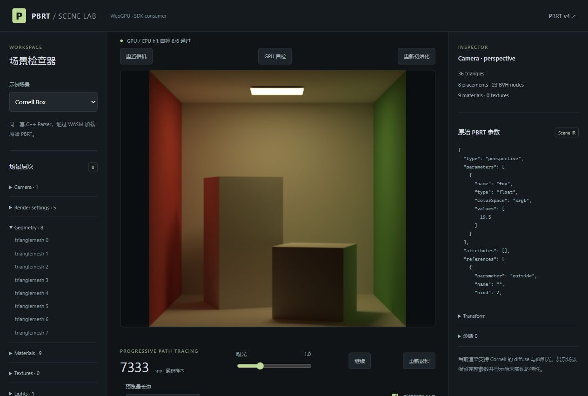
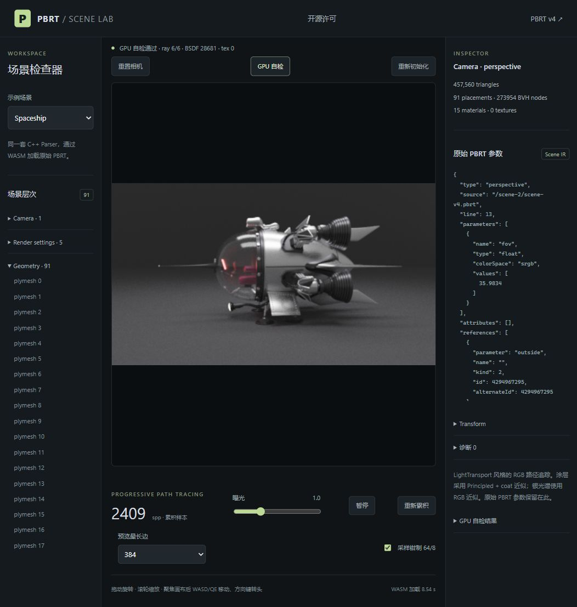

# pbrt-v4-parser

独立、仅依赖标准库的 C++20 PBRT-v4 场景解析 SDK。用于把 PBRT 文件加载为渲染器无关的 Scene IR，可接入 CPU、CUDA、DXR、Vulkan 或 WebGPU 渲染器；核心库不依赖这些后端。

当前为 **0.1 开发版**：核心 Parser、SceneBuilder、共享实例 IR、可选 PLY/Geometry Utilities、CLI 和 Tiny CPU Path Tracer 已可运行。**WASM/WebGPU 尚未实现；尚未完成首版发布验收。** 覆盖与限制见 [Compatibility](docs/compatibility.md)，本机证据见 [实施记录](docs/implementation-plan.md)。

```cpp
#include <pbrt4/pbrt4.h>
#include <iostream>

int main() {
    auto result = pbrt4::load("scene.pbrt");
    for (const auto& d : result.diagnostics)
        std::cerr << pbrt4::format(d) << '\n';
    if (!result) return 1;
    const auto& scene = result.scene;
    for (const auto& instance : scene.instances) {
        const auto& object = scene.objects.at(instance.object);
        // object.shapes references shared entries in scene.shapes.
        // instance.transform and each shape.transform remain separate.
    }
    // Non-instanced shapes are listed in scene.world_shapes.
}
```

构建要求：CMake ≥ 3.21、C++20 编译器。已在 Windows MSVC 19.38 与 GCC 10.3 构建；Linux CI 已配置，尚未执行。无需下载任何依赖。

```powershell
cmake --preset msvc
cmake --build --preset msvc
ctest --preset msvc
build-msvc/Debug/pbrt4_info.exe testdata/cornell.pbrt
build-msvc/Debug/tiny_pathtracer.exe scenes/cornell-box/scene-v4.pbrt out.ppm 64 256
```

Linux 或已设置编译器环境的 Ninja：

```sh
cmake -S . -B build -DCMAKE_BUILD_TYPE=Release
cmake --build build --parallel
ctest --test-dir build --output-on-failure
./build/tiny_pathtracer scenes/cornell-box/scene-v4.pbrt out.ppm 64 256
```

约 250 行的 [Tiny Path Tracer](examples/tiny_pathtracer/main.cpp) 以 `scenes/cornell-box/scene-v4.pbrt` 为主要验收场景，使用同一 C++ SDK，提供中位数 BVH、Lambertian、面积光直接采样、常量环境光、triangle filter、Monte Carlo 反弹与 Russian roulette，输出 P6 PPM。可选末尾参数为预览图像最长边；省略则保留 Film 分辨率。球体离散化只在 Geometry 消费层显式开启。它会拒绝不支持的材质/纹理/动画等渲染输入，不能视为 PBRT 的渲染结果复现。

普通 CMake 集成：

```cmake
add_subdirectory(external/pbrt-v4-parser EXCLUDE_FROM_ALL)
target_link_libraries(my_renderer PRIVATE pbrt4::pbrt4)
# Optional: target_link_libraries(my_renderer PRIVATE pbrt4::geometry)
```

也可用 `FetchContent_Declare(pbrt4 SOURCE_DIR /path/to/pbrt-v4-parser)` + `FetchContent_MakeAvailable(pbrt4)`；发布远程后可改为 Git URL 和固定 commit。库作为子项目时默认不构建测试、CLI、示例。核心构建可用 `-DPBRT4_BUILD_GEOMETRY=OFF` 关闭可选几何模块。

安装与包消费：

```sh
cmake --install build --prefix /path/to/install
# Multi-config MSVC: add --config Debug (or Release).
```

```cmake
find_package(pbrt4 0.1 CONFIG REQUIRED)
target_link_libraries(my_renderer PRIVATE pbrt4::pbrt4)
```

向消费者的配置命令传入 `-DCMAKE_PREFIX_PATH=/path/to/install`。`BUILD_SHARED_LIBS=ON` 可构建共享库。

三层公共 API：

| 层次 | 入口 | 责任 |
|---|---|---|
| 语法 | `parser.h`: `Tokenizer`, `parse_file`, `parse_string`, `ParserTarget` | 原始指令、typed parameters、文件边界与诊断 |
| 场景 | `pbrt4.h`: `load`, `load_string`, `SceneBuilder` | 图形状态、Transform、具名引用、共享对象与实例 |
| 可选几何 | `geometry.h`: `load_ply`, `extract_geometry`, `bake_instance` | 原始局部网格、共享 mesh instances、显式静态烘焙 |

Include 与 Import 均支持自定义虚拟文件系统；相对路径默认相对根 PBRT 文件。光谱、颜色空间、材质类型、动画端点和原始参数均保留，不改写成简化 PBR 材质。解析错误带文件、行、列，不退出进程。详见 [API](docs/api.md)、[架构](docs/architecture.md)、[上游与许可证](docs/upstream.md)。

官方回归只下载约 0.3 MB 的固定版本描述文件，不下载大型资产：

```sh
python tools/official_regression.py --info build/pbrt4_info
```

Windows 指定 `--info build-msvc/Debug/pbrt4_info.exe`。该测试验证解析与 IR，不验证官方场景的外部 PLY/贴图解码或渲染。第三方场景保留其各自许可证；SDK 新实现使用 Apache-2.0。

本地 [Bathroom / Spaceship 示例](scenes/README.md) 可通过复制脚本准备资产，并用 `pbrt4_info --details --check-resources --geometry scene.pbrt` 检查资源与全部网格。这两份原始场景目前通过加载回归，**Tiny 尚不能正常渲染**，具体缺口见 [检查报告](docs/example-scenes-validation.md)。

Tiny 的范围限定为 Cornell Box；Bathroom / Spaceship 由独立 WebGPU 消费者渲染。

独立 [WebGPU Scene Lab](web/README.md) 使用同一 C++ SDK → 单线程 WASM Worker → BLAS/TLAS → WGSL megakernel。**Cornell、Spaceship、Bathroom 均已在真实浏览器渲染**，支持 GGX 金属、粗糙/理想玻璃、LT 涂层近似、TGA/mip、独立 alpha、bump、Inspector 与线性 HDR 导出。三场景几何/材质/图片数据已做 native/WASM 一致性比较，已记录的 RGB 与材质近似不等同于完整 PBRT。安装与启动见 Web README，实际证据见 [两场景实施记录](docs/webgpu-scenes-validation.md)。






[在线 WebGPU Scene Lab](https://breeze028.github.io/pbrt-v4-parser/) · [固定示例资源](https://github.com/breeze028/pbrt-v4-parser/releases/tag/scenes-v1)。首次切换 Bathroom 会下载约 64.5 MB 原始资源包并生成 mip，需要支持 WebGPU 的浏览器。
