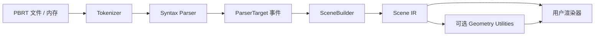

# 架构与源码复用决策

这是独立 C++20 SDK，核心只使用标准库。LightTransport 原仓库只读。

## 复用决定

- LightTransport 的 Token/Param、作用域和 PLY 加载经验值得参考。但 `pbrt_loader.cpp` 直接创建 `lt::Mesh/Material`、转换光谱、烘焙 Transform；`scene.h` 还承载渲染器设置，不能移植为 SDK IR。没有发现其根目录 LICENSE，因此不复制其实现。
- 官方 `ParserTarget` 将语法事件与 Builder 分开，这一边界采用；官方 Parser/ParameterDictionary 依赖 pstd、allocator、error-exit、光谱和颜色系统，BasicSceneBuilder 又依赖真实材质/几何工厂与任务系统。独立重写，不链接官方框架。
- ingowald/pbrt-parser 的 syntactic/semantic 两层 API 值得参考，但 PBRT 版本覆盖须单独核对，不能当作 v4 权威。
- miniScene 的 Mesh → Object → Instance 共享层次值得采用；简化材质转换不适合作为保真 IR。
- mxpv/pbrt4 是 Rust 实现，可参考易用入口与 typed parameters；不引入 Rust 或重复 parser。

## 所有权与数据边界

事件、参数、源位置均拥有字符串，不暴露悬空 string_view。Scene 用 vector 管理实体，通过稳定的索引 ID 引用；几何定义与实例分离。Shape 保留原参数、对象变换、材质、介质与面积光状态；实例保留对象 ID 和独立动画变换。

Parameter 保留声明类型及 `int64/double/bool/string` 值，Spectrum 不做 RGB 转换。声明参数与 Attribute 继承参数分开，颜色空间记录到参数与实体。资源引用保存原字面值及解析后路径；不会读取图片或自动生成 UV。

矩阵使用行优先存储、列向量运算，PBRT 文件的列优先矩阵在边界转置。CTM 后乘操作矩阵。Camera 存 world-from-camera；LookAt 的 CTM 是 camera-from-world。动画保留起止矩阵和时间，不在核心做插值。

Include 是共享状态的文本式展开；Import 使用继承状态的独立分支，不泄漏状态/坐标系，保留产出的实体。按照格式文档隔离 Import 新增名称对父文件的可见性；并发执行不是语义必要条件，初版顺序执行。路径默认相对根 PBRT 文件目录，而非当前 Include 文件目录。循环和深度限制返回诊断。

Syntax API 可以独立于 SceneBuilder 使用；Geometry Utilities 独立 target，不是 parser 的依赖。失败返回含 SourceLocation 的诊断，库不退出进程；部分 Scene 仅用于检查，不应在 result 失败时直接渲染。
