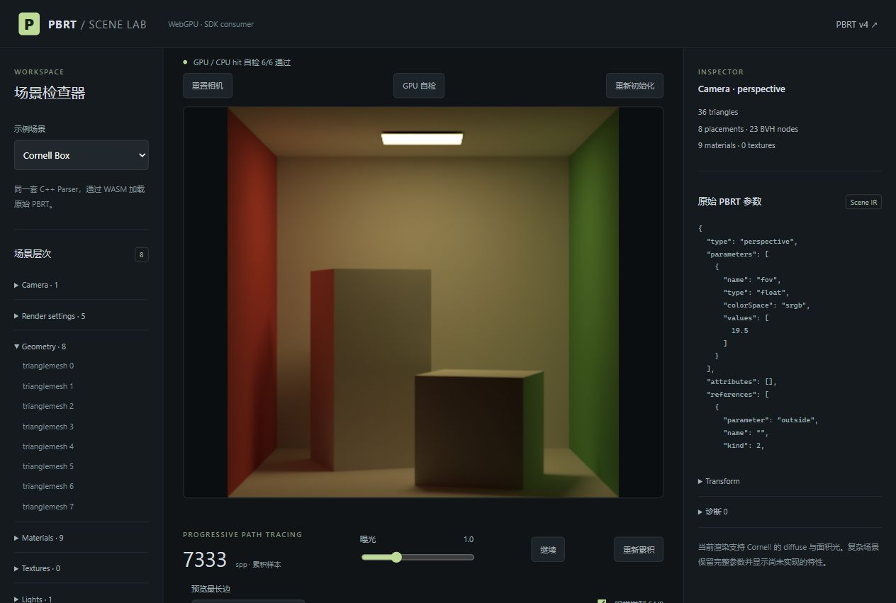

# WebGPU 首批实现与验证

后续 Spaceship / Bathroom 已接入 WebGPU，当前实现与新证据见 [两场景实施记录](webgpu-scenes-validation.md)。本文保留首批 W0–W2 的历史状态与验证范围。

日期：2026-11-15（Asia/Shanghai）。目标是计划第 8 节的首批数据链路与 Cornell 闭环，不是两个复杂场景的渲染验收。

## 当前阶段

| 阶段 | 当前结果 | 尚未关闭的条件 |
|---|---|---|
| W0 移植契约 | 已记录固定来源、逐函数映射、当前支持/拦截、布局、采样差异与 MIT 归属 | 同配置 CUDA HDR reference、复杂 BSDF 测试向量、上游派生 shader 的公开许可声明 |
| W1 WASM / 几何数据 | 三场景同 SDK、MEMFS/Worker/handle 生命周期、原始资源包、共享 BLAS/TLAS、异常恢复；native/WASM 元数据和四数组比较通过 | 图像解码及像素方向测试随 W4 实现；固定大型资产下载地址尚未提供 |
| W2 Cornell Compute | 已有真实 WebGPU 图像、NEE/MIS、相机/filter、累积/显示、Inspector、GPU/CPU 求交与法线对比、实际交互 | 仅确认本机浏览器基线；未做跨设备矩阵、性能基准或 CUDA 图像一致性验收 |
| W3 Spaceship | 可加载并检查 457,560 triangles | GGX conductor、coat、dielectric、常量环境、透明阴影与材质测试，尚未开始渲染验收 |
| W4 Bathroom | 可加载并检查 592,188 triangles，完整保留 12 个纹理声明 | TGA、encoding/mip、独立 alpha、bump、具名光谱 RGB、完整实例/资源 Inspector |
| W5 Pages | 完整复制指定 skill + MIT，新增 web CI、生产改名子路径验证 | CI 未远程执行；未创建 remote、固定大型资产托管、发布 workflow 或线上部署 |

Tiny 与 SDK 的既有实现保持原范围。`PBRT4_BUILD_WEB` 默认关闭，标准 C++ 核心没有新增默认依赖。

## 数据协议与支持约束

入口为 `web/cpp/scene.h`，GPU layout v1。C++/WASM 共用 `scene.cpp`，四个输出数组由 Worker 复制后 transfer 到主线程，不将几何逐顶点转换为 JS 对象。矩阵为 row-major，作用于 column vector；world/local ray 的 t 在不归一化局部方向时保持一致。BLAS 复用网格，TLAS placement 记录原 shape/material ID 与方向标志。

CPU median BVH 使用确定的 centroid + 原 index 排序；叶最多 4 项，构建深度限制 60，边界向外扩展到相邻 f32。GPU 两层分别使用 64 槽迭代栈；栈溢出有独立失败标志与计数，不视作 miss。布局含尺寸/offset static assertions。

当前渲染支持静态透视、triangle/box filter、三角网格/PLY、常量 RGB diffuse、RGB diffuse 面积光。其他材质、图片/光谱参数、独立 alpha、介质、动画、未实现相机/Film/filter/Integrator 参数会诊断并阻止渲染；SDK 原始参数仍保留。Sampler / Accelerator 是显式消费者策略：Inspector 展示原始声明，执行采用 PCG / 自有 BVH；不宣称 Sobol 或官方 Integrator 等价。

## 本机工程与数据证据

实际工具：Windows/MSVC、Node 24.22.3、Emscripten 7.0.0，npm lockfile 固定 Vite 8.3.8、TypeScript 7.0.2、WebGPU types 0.1.69。

- `cmake --build build-web-native --config Release --parallel 4` 与 CTest：**35/35**，含既有 34 项与新增 web scene contract；Tiny 渲染回归仍通过。
- `npm run build:wasm --prefix web`：实际编译单线程 SDK / Geometry / adapter / bridge，明确开启异常处理。
- `npm ci --prefix web`：干净安装通过。第一次因仍运行的 Vite 锁住 Windows 原生扩展而失败；停止本轮 dev server 后重跑成功，未提升权限。
- `PBRT4_WEB_LARGE_SCENES=1` 后 `npm test --prefix web`：**5/5**。三场景元数据在规范化虚拟根路径后相等，包括已导出的 typed params、transforms、references、diagnostics；四个 GPU 数组逐字节相等。另有 Include/Import 隔离、坏输入/缺文件/作用域错误后恢复、共享对象两 placement 不复制 BLAS、close 后 buffer 不可访问。
- 当前默认 CI 只运行 Cornell 与两组 fixture（3 项），不会把本机未跟踪的大型资产当作 CI 已有输入。

实际数据如下。三角形和 placement 是 SDK/适配器计数；字节是四数组之和，**不是 GPU 实际显存占用**。两个大场景在渲染拦截前未上传 GPU。

| 场景 | vertices | triangles | placements | BVH nodes | 最大深度 | 四数组总字节 |
|---|---:|---:|---:|---:|---:|---:|
| Cornell | 72 | 36 | 8 | 23 | 2 | 6,720 |
| Spaceship | 368,377 | 457,560 | 91 | 273,954 | 16 | 33,811,312 |
| Bathroom | 362,068 | 592,188 | 856 | 364,427 | 15 | 38,655,104 |

原始包实测：Cornell 2 文件 / 7,763 B；Spaceship 90 文件 / 16,268,468 B；Bathroom 867 文件 / 64,517,898 B。包含场景许可证；不包含 `.lt` / `.ivol`。SHA256 由构建脚本生成，Worker 每文件校验，原始 PBRT 仍经 WASM SDK 解析。

## 生产 HTTP 与实际浏览器证据

使用 `PAGES_BASE_PATH=/renamed-project/` 构建并预览生产 `web/dist`，地址为本机 `http://127.0.0.1:5181/renamed-project/`。已通过 `web/scripts/check-http.mjs`：HTML/JS/CSS/worker 的状态和 MIME、WGSL 内嵌、WASM magic/MIME/实际编译、manifest 与 Cornell 包哈希。该脚本曾抓出错误资源请求返回 HTML fallback，修正了检查脚本的 URL 提取；没有将 HTTP 200 当作资源成功。

在 Codex 内置浏览器实际观察：

- Cornell 由 compute shader 追踪并累积，最终截图 **7333 spp、384×384**，相机 fov=19.5、maxdepth=65，默认 64/8 clamp、曝光 1.0。
- `GPU 自检` **6/6 通过**：独立 CPU 世界空间 brute-force 对同一 buffer 数据比较 GPU BVH 命中 ID、t、重心坐标、几何法线与插值法线，绝对容差 `1e-3`。同一自检在拖动后的相机上再次通过。只覆盖这 6 条射线，不视为所有变换/边界输入的完整证明。
- 暂停后 spp 保持 **2473**；曝光 1.0→1.1 后仍为 **2473**；128 / 256 预览分辨率修改时 spp=0、canvas 尺寸正确，继续后恢复采样。相机拖动时 spp=0，重置相机后恢复原构图。
- Inspector 选择 `trianglemesh 5` 实际展示原始 uv / `normal N` / P / indices 和 material ID；没有将 PBRT 材质参数替换成简化表单。
- 依次切 Spaceship、Bathroom，显示对应计数、15/33 materials、0/12 textures，以及 10/28 条渲染能力诊断，保持 **0 spp**。切回 Cornell 后重新出图。
- 最终生产 tab 的 Console warning/error 记录为 **空**，包含上述场景切换过程。早期 dev tab 的 WGSL 保留字、管线布局、自检重复 getMappedRange 错误均已修复；最终生产 tab 没有这些错误。
- screenshot 与本机 `out/webgpu/browser-evidence.json` 来自同一次观察，UTC `2026-11-14T18:21:12.813Z`。本轮临时服务器在验证后停止，图中本地地址不代表持续托管服务。
- 截图后仅补齐 bridge 翻译单元的显式 `-fexceptions` 编译标志；随后重跑三场景 WASM 回归和生产构建/HTTP 检查，没有再打开浏览器复验这项编译设置。

这些是 Agent 的本机浏览器观察，不是用户人工验收。未做真实移动设备、device lost 自动注入、跨 GPU、线上或 CUDA 图像误差测试；没有 GPU 时间数据或帧率承诺。

## 继续工作的入口

下一步 W3 从 `web/THIRD_PARTY.md` 的源函数映射继续：先增加 Fresnel/GGX 与连续/delta PDF 测试向量，再移植 conductor、coat、dielectric，随后接常量 infinite 与透射阴影。保留现有 Cornell 基线与所有数据测试；在材质缺口关闭前不取消 Spaceship 的渲染拦截。

Bathroom 在 W4 补 TGA/角色编码、alpha mask 与 bump；W5 再准备可重建的大资产分发与真正 Pages 发布。运行入口见 [web/README](../web/README.md)，指定发布 skill 为 [.agents/skills/webgpu-github-pages/SKILL.md](../.agents/skills/webgpu-github-pages/SKILL.md)。
