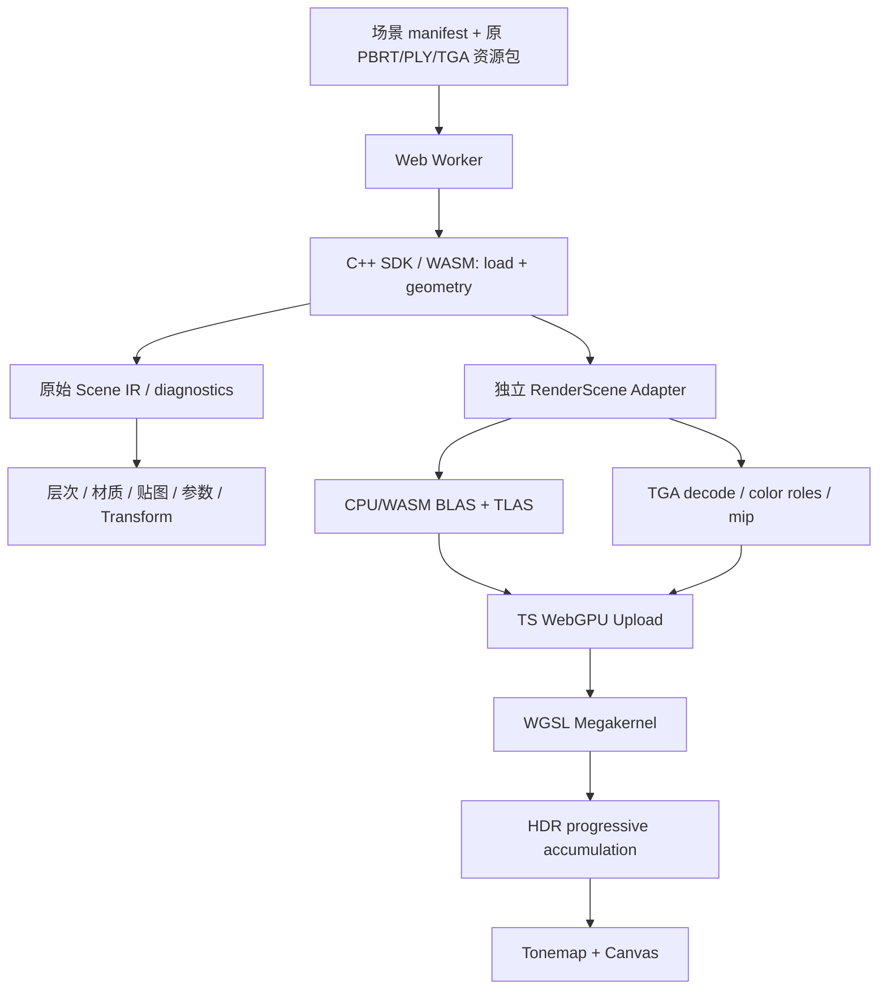

# WebGPU Renderer 实施计划

状态：2026-11-15，源码调研后的设计计划；本轮没有实现 WASM/WebGPU 或执行发布。用户指定 Tiny CPU Renderer 保持 Cornell Box 范围，WebGPU 消费者负责推进 Spaceship / Bathroom。

## 1. 技术路线与验收口径

采用 **C++ SDK → 单线程 WASM Worker → 独立 RenderScene 适配 → WGSL Compute Megakernel → 渐进累积 → 显示**。原始 Scene IR 同时供 Inspector 使用。

LightTransport 的 CUDA megakernel 是主要移植来源。按函数抽取并翻译成 WGSL，保留采样权重、PDF、MIS、透射、ray offset 与错误预算等约定；不将 CUDA runtime、D3D11 interop 或 LightTransport Scene/Material 类型带入核心 SDK。

本方案取代此前 M4“先完整 Raster Viewer，再可选 Path Tracer”的顺序：优先做真实路径追踪，Inspector 随数据链路接入；Raster 拖动预览仅在确有需要时增加。暂不移植 wavefront、ReSTIR、SVGF、Lightmap、Irradiance Volume、Editor 或 GPU BVH build。

首版是 **LightTransport 风格的 RGB 路径追踪消费者**，不承诺 PBRT 光谱或全部材质工厂等价。适配中的近似逐项记录，不改变原 PBRT 文件与 Scene IR；不把“能显示画面”称作“所有 PBRT 参数已支持”。

## 2. 本轮核实的源码依据

| 来源 | 固定版本 | 本次读取 |
|---|---|---|
| `F:\code\LightTransport` | `47a461d267ed61c2c30c5054d98290ab107da581`，工作树干净 | `src/gpu/{kernel,shading,intersection,types,scene_upload,math,ray_query}.cuh` 中主要入口与相关实现；`cuda_path_tracer.cu` 调用链；`src/pbrt/pbrt_loader.cpp`；`src/texture.cpp`；`include/lt/{renderer,material,scene}.h` |
| `F:\code\webgpu-pages-starter` | `468bee0d5f3527d7523f826cf4c64872f70d3385`，工作树干净 | `.agents/skills/webgpu-github-pages/SKILL.md`、`references/deployment.md`、模板、实际 workflow、Vite/base/device、README 与实施记录 |
| 本地官方 pbrt-v4 | `b0bdf461ba5dd6504b70ebf0932acc0fe7aa744f` | `textures.cpp`、`materials.h::BumpMap`，区分纹理编码、scalar imagemap 和材质 displacement |

### 移植清单

| 源码位置 | 保留的逻辑 | WebGPU 适配 |
|---|---|---|
| `kernel.cuh::render_kernel` | 每像素 seed、取样、累积、显示分离 | `global_invocation_id`；一个 invocation 追踪一条完整路径，首版每 dispatch 1 spp |
| `shading.cuh::trace_gpu` | throughput、上一事件 PDF/delta、emitter 命中、NEE/MIS、RR、额外透射计数 | 迭代 WGSL；可配置深度和明确终止诊断 |
| `evaluate_brdf_gpu/material_pdf_gpu/sample_material_gpu` | Lambertian、GGX conductor、Principled coat、dielectric Fresnel/折射 | WGSL 函数；分清连续 PDF 与 delta 离散事件 |
| `estimate_direct_gpu/light_pdf_solid_angle_gpu/mis_weight_gpu` | 面积光选择、面积到立体角 PDF、MIS | 独立 light 表，发光几何与采样表双向索引 |
| `intersection.cuh`、`ray_query.cuh` | AABB/triangle、closest-hit、shadow、ray offset、遍历预算 | f32/u32 显式布局；迭代 BVH2，之后按证据优化 |
| `types.cuh` | traversal 与 shading 数据分离、稳定 ID | 重设计 GPU records，不能直接 memcpy 含指针、bool、CUDA handle 的 struct |
| `scene_upload.cuh` | 数据打包的责任划分与校验 | 自有 C++ RenderScene/BVH packer + TS GPU upload，不移植 CUDA 分配代码 |
| `pbrt_loader.cpp` | 材质映射、roughness remap、具名金属光谱 RGB 近似经验 | 从 SDK Scene IR 读取，不复用其 Tokenizer/Parser 或几何展开 |

按本轮用户明确提出复用 LightTransport 的要求推进抽取。核心 SDK 仍保持独立；消费者复制/改写时记录文件、函数、commit、修改与作者归属。LightTransport 根目录当前未见 LICENSE，不据此把全仓库或第三方组件自动视为 Apache-2.0；具体移植文件的许可声明和第三方归属应在首批实现时一并落到 NOTICE/upstream 记录。部署 starter 为 MIT，复制 skill/脚本/模板时保留其许可证归属。

## 3. 两个目标场景：抄完还缺什么

既有加载检查：Spaceship 457,560 triangles，无图片；Bathroom 592,188 triangles，12 个 imagemap 声明、10 个唯一 TGA，全部输入已存在。下面是消费者的工作，Parser 不丢参数。

| 特性 | 现有 LightTransport 路径 | 本项目决策与验收 |
|---|---|---|
| diffuse、面积光、常量 infinite | 已有对应 BSDF/光源路径 | 先移植；验证发光面朝向、选择 PMF、MIS，禁止重复计光 |
| conductor | eta/k Fresnel、GGX、roughness remap | 保留参数规则与零粗糙度分支；银的具名 eta/k 采用显式 RGB 近似 |
| coateddiffuse | Loader 映射为 Principled + clearcoat，并钳制 coat roughness | 第一阶段采用并标记 LT 近似；不是 PBRT layered coateddiffuse。极低 roughness 的钳制需单独列出 |
| dielectric | Loader/采样路径为理想 delta 折射，未使用原场景粗糙度 | 先移植理想玻璃验证 Fresnel/TIR；Spaceship 完成条件包括其 rough dielectric 参数求值，不能忽略 .01 roughness 后宣称完整支持 |
| 独立 Shape alpha | CUDA 有基于材质 base texture alpha 的可见性；本地 PBRT Loader 未接入 `texture alpha` | 适配层新增独立 Shape alpha 引用，主路径/阴影统一；不能从 Rug 颜色纹理的 A 通道替代 rug_mask |
| 材质 displacement | 本地 PBRT Loader 未接入 | Bathroom 两个材质的该参数按 height/bump 扰动 shading normal，实现 UV 微分与几何法线一致性；不是改动网格轮廓的真实几何位移 |
| scalar / spectrum imagemap | LT 按纹理角色设置颜色空间 | 新增角色/编码明确的纹理适配。scalar 取样独立于颜色；颜色与数据不可共享错误的 sRGB 解码或 mip 链 |
| 透射阴影 | LT 允许直线穿越玻璃，有有限遍历预算 | 保留并明确是近似，不等于折射阴影/焦散；预算耗尽记录 unresolved，不能当可见 |
| 相机 / triangle filter / 深度 | SDK 保留，Tiny 已覆盖这三个场景的基本参数 | 通过同一 IR 获取；Web 不改原始 maxdepth=17/65。交互预览降低分辨率/spp，明确展示所用配置 |

**重要语义：** PBRT 材质的 `displacement` 用于 bump mapping；Shape plymesh 上的 displacement 才是另一条几何位移功能。后者不属于当前 Bathroom 这两个材质参数的需求。[官方格式说明](https://pbrt.org/fileformat-v4#materials)

10 个 TGA 已实际检查 header：全部为 type 2、24-bit、top-origin，尺寸最大边 2048。rug_mask 也没有有效 A 通道，必须走 float texture 的像素值；无有效 alpha 时的 RGB scalar 归约以官方 RGB 平均规则为参考，不能读取恒为 1 的 A。颜色图与 scalar 图的 encoding、flip-V、UV wrap、mip/LOD 分别测试；不能假设浏览器原生图片加载器会读取 TGA。

LT 颜色角色使用 sRGB；本地官方 PBRT 的默认 encoding 只对 PNG 默认 sRGB，其余默认 linear。这一差异必须记录。首版以 LT 风格 RGB 为展示基准，原始 encoding/类型仍留在 IR，不能声称颜色与官方 PBRT 默认严格一致。比较测试必须锁定相同 encoding。

## 4. 数据链路与工程边界



建议目录（待实现，不创建空壳冒充交付）：

```text
web/
  cpp/                 WASM bindings / RenderScene adapter / BVH / optional image codec
  src/worker/          资源获取、虚拟文件表、WASM 生命周期
  src/renderer/        GPU 资源、上传、调度、累积、相机
  src/shaders/         layout / math / traversal / bsdf / lights / pathtrace / present
  src/inspector/       原 IR 数据检查与选择联动
  tests/               布局、WASM、材质、GPU 合约、资源路径
  public/scenes/       构建时生成的 manifest/资源包
  package.json + package-lock.json + vite.config.ts
docs/webgpu-*.md
.github/workflows/web-ci.yml + deploy-pages.yml
```

### WASM

- C++ Parser、PLY 仍使用同一 SDK；TS 不解析 PBRT。只在 `web/cpp` 链接可选图像解码与 BVH packer，不增加核心库默认依赖。
- 单线程 Emscripten 模块在普通 Worker 中运行，首版不依赖 pthread、SharedArrayBuffer 或跨源隔离。pthreads 需要 COOP/COEP；GitHub Pages skill 也明确提示此托管限制。[Emscripten 文档](https://emscripten.org/docs/porting/pthreads.html)
- 显式开启 C++ 异常捕获并测试 `Abort`/文件错误，不能让 WASM 的构建缺省选项破坏现有诊断机制。
- 网络读取先异步完成，再以 `LoadOptions.read_file` 与 `GeometryOptions.resources.read_file` 提供同步文件表；根目录固定为 `/scene/`。沿用根文件路径、Include/Import 语义。
- 原始参数/层次使用小型元数据；大数组用 typed array + offset/count，避免把每个顶点变成 JSON/Embind 对象。WASM 内存增长后重新获取 view；GPU 上传和转移完成前不释放其来源；定义显式 scene handle/dispose 协议。
- 原生和 WASM 对同一场景比较实体数量、引用、Transform、诊断及几何数据；图片解码比较原始像素和方向。

### 资源包

先内置 Cornell → Spaceship → Bathroom，按需下载，一次只常驻一个完整场景。避免 Bathroom 启动时发起 865 个独立文件请求。

构建工具生成版本化 `manifest.json + resources.bin`：manifest 包含虚拟路径、offset、size、SHA-256、根文件和许可证；binary 仅打包原始文件，不把解析过的 IR 当作浏览器解析入口。加载仍走 WASM SDK。初版不依赖 HTTP Range 或服务器解压；上传场景包之后可新增 ZIP 导入，统一映射到相同文件表。

当前模型和纹理被 Git 忽略，CI 不会凭空拥有它们。实施时将原始资产制成固定版本下载包（优先 Release asset），登记实际 URL/hash/LICENSE；CI 校验后生成站点资源。浏览器从 Pages 本站下载生成包，避免运行时跨源依赖。Cornell 的小型原描述可以直接随源码提供。此轮不创建 Release 或远程仓库。

## 5. WebGPU 实现约束

### 布局与几何

- 只采用可移植 WebGPU Compute + WGSL，不要求硬件 ray tracing、bindless、f16 或 subgroups。
- f32/u32 GPU 数据协议版本化，统一矩阵约定、无效 ID、字节序和 padding；native/WASM/TS/WGSL 共享布局测试。`vec3f` 对齐不能当 C++ 的紧凑 12 B struct memcpy。
- 静态 CPU/WASM BVH2，保留 mesh-local BLAS 和 placement/TLAS；ObjectInstance 不复制几何。世界 Shape 也可视作 placement。命中记录稳定链接回原 Shape/Material/Instance ID。
- 首版建议 vertex 48 B、primitive 16 B、BVH node 32 B；不是已确定 ABI，W1 布局测试后冻结。统一 scene record arena 放材质、light、instance 与 texture metadata，避免每种数据占一个 storage binding。
- 初始 compute 计划约 6 个 storage bindings：nodes、vertices、primitives、scene records、accumulation、diagnostics。实际大小/数量先检查 adapter/device limits 并只请求所需限额。[WebGPU limits](https://www.w3.org/TR/webgpu/#limits)

按上面布局、二叉树最多 `2*T-1` nodes 粗估：Bathroom 约 **61.8 MiB** 几何，Spaceship 约 **51.8 MiB**；不含纹理、累积、CPU/WASM 副本、临时构建或驱动开销。这是预算估算，不是实测 GPU 占用。不会预先宣称所有手机可运行。

### 纹理

- 首版为这两个目标场景使用固定纹理 slots + WGSL switch，避免依赖绑定数组扩展；超出容量时明确报错或选择后续 atlas 方案，不静默丢纹理。
- 12 个 imagemap 名称、10 个唯一文件不等于 10 个 GPU texture：floor_tiles 同时用于 spectrum 与 float。按“内容 + encoding/role + mip policy”去重，分别生成正确颜色/数据 mip；当前目标约 11 个实际 role texture，启动时核对所需 sampled-texture 限额。
- 不将所有图填充到 2048×2048 texture array；它会增加约数倍显存。原始尺寸 RGBA8 + 全 mip 粗估为 77.8 MiB，双角色副本等另计。
- Compute 使用 `textureSampleLevel` 等显式 LOD；实现 mip 与 ray cone/UV 密度估计后才标为 trilinear 覆盖。LOD0 可作为单元比较配置，不能假称实现全部过滤。[WGSL textureSampleLevel](https://www.w3.org/TR/WGSL/#texturesamplelevel)

### 调度与正确性

- 每 dispatch 1 spp，8×8 workgroup 起步；host 可按瓦片和设备耗时缩小调度，禁止把整张大图的 64 spp 全塞进一个长期 kernel。
- 累积按 sample index 管理 RNG 与计数。相机、分辨率、材质、场景变化会重置；旧 Worker 结果使用 generation ID 丢弃，不跨场景累积。
- 显示是单独 pass；保持 HDR，显示曝光/tonemap 不重置路径累积。首版无需每帧将整张 HDR map 回 CPU。
- BVH 栈、透明穿越、NaN/Inf 都有诊断计数。栈溢出不得视作普通 miss；构建端限制深度，GPU 仍检测异常。WGSL 不允许递归，遍历/路径使用循环。[WGSL 函数规则](https://www.w3.org/TR/WGSL/#functions)
- 源 `trace_gpu` 包含 primary/secondary 的 64/8 sample clamp、RR 概率 .05–.95、额外透射计数等行为。逐项记录是否保留；参考配置保持同条件，误差测试提供不钳制模式。不能无声移除或引入这类有偏操作。
- 可选 timestamp-query；不支持时继续渲染。显示的 GPU pass 时间、CPU frame 时间、spp 分开，不承诺 60 FPS；基准从实际浏览器中测量。
- 沿用 starter 的能力失败处理：安全上下文、缺 API、null adapter、device 请求失败、shader/pipeline 编译信息、uncaptured error 与 device lost；显示明确状态、停止错误帧循环并提供资源重建入口。场景切换/resize/dispose 的生命周期单独验证。

## 6. 实施顺序与关闭条件

| 阶段 | 实现工作 | 可关闭的证据 |
|---|---|---|
| W0：移植契约 | 固定来源/归属，材质/纹理覆盖矩阵、采样与布局测试向量；确定 native LT 与 Web 比较设置 | 不能以现成 TungstenRender 图代替本次 CUDA reference；标出 LT 近似与新增部分 |
| W1：WASM + 数据 | 单线程 Worker、同 SDK 解析、几何/元数据、资源包、BLAS/TLAS、诊断 | native/WASM 对 Cornell/两大场景的数量、引用、数组一致；异常返回不崩；共享实例测试不增长重复几何 |
| W2：Cornell Compute | 基础遍历、diffuse、面积光 NEE/MIS、相机、triangle filter、累积与显示；最小 Inspector | 真 GPU hit/barycentric/normal 对 CPU；固定相机实际图像、相机移动重置、resize、无 Console 错误 |
| W3：Spaceship | GGX conductor、coat 近似、理想与粗糙 dielectric、常量环境、透明阴影 | 457,560 triangles 的完整场景；roughness/TIR/PDF/能量测试，玻璃/金属局部图，所有材质有映射；未支持参数清单为空或明确约定的近似 |
| W4：Bathroom | TGA/encoding/mip、独立 alpha、bump、具名银光谱 RGB、完整 Inspector | 592,188 triangles；检查 rug mask、木纹/墙纸、镜面、粗糙金属、浴缸、地砖/泡沫 bump；无黑贴图/缺资源/遍历溢出；报告剩余近似 |
| W5：Pages | 复用指定 skill、固定资产、生产 base 检查、CI、真实线上浏览器 | 同 commit 的工程/静态 HTTP/浏览器 GPU/线上四层证据，不用 workflow 绿灯替代画面验收 |

W3 前已有可交互 Cornell 页面，W4 后才允许把两个复杂场景标记为该版本的已验收展示。W1 和后续阶段都保留 core 与 Tiny 原有测试。统计误差用线性 HDR、多 seed 与一致色彩设置比较，不能把 Monte Carlo 噪声当逐像素确定性失败，也不能仅凭“看起来像”判定材质正确。

## 7. 发布流程：采用指定 skill

权威本地入口：`F:\code\webgpu-pages-starter\.agents\skills\webgpu-github-pages\SKILL.md`，读取版本同上。实际搭建时将完整 skill 目录及 MIT 归属带入本仓库 `.agents/skills/`；不复制其立方体 renderer。

拟定构建顺序：

```text
native core checks
  → pinned Emscripten + WASM build/tests
  → fixed asset package download + SHA256/license check
  → web/npm ci
  → web tests + typecheck + WGSL/GPU contract checks
  → generate public/scenes + WASM assets
  → Vite production build (web/dist)
  → renamed-subpath HTTP/resource validation
  → upload-pages-artifact(web/dist)
  → deploy-pages
  → actual URL resource/Console/GPU observation
```

- 使用 TypeScript + WGSL + Vite，固定兼容 Node（初始跟随 starter 的 Node 24）与 lockfile；实施时核实版本，不照抄时间敏感依赖声明。
- 新增独立 `web-ci.yml` / `deploy-pages.yml`，保留现有 C++ CI。web working directory 与 `cache-dependency-path: web/package-lock.json` 明确配置；Emscripten 构建可在 `web` 前置步骤执行，不假设 npm 能自动产生 WASM。
- workflow 使用官方 configure-pages → upload-pages-artifact → deploy-pages，保持最小权限与 `github-pages` environment；PR 只检查，生产发布限部署分支。Action tag/SHA 按 skill 在实施时核实。[GitHub 官方工作流](https://docs.github.com/en/pages/getting-started-with-github-pages/using-custom-workflows-with-github-pages)
- base 来自 `configure-pages.base_path`；本地生产构建额外模拟改名路径。`import.meta.env.BASE_URL`、Worker URL、WASM glue 的 locateFile 和 manifest 内部引用必须使用同一挂载根，不硬编码用户或仓库名。
- WGSL 作为文本进入 bundle；WASM/worker/场景包逐项检查真实内容与 MIME，不能把返回 HTML 的 HTTP 200 当成功；WASM 应可实际实例化。
- 当前约 77 MiB 原场景依赖有望放入静态 artifact，仍须检查完整产物与传输预算。Pages 有站点容量/带宽等限制，按需下载场景，不预加载两个大包。[Pages 限制](https://docs.github.com/en/pages/getting-started-with-github-pages/github-pages-limits)
- 生产发布须对应实际远程与用户发布要求。当前仓库只有本地 main、没有 remote；此轮是计划，不新建远程、不启用 Pages、不推送或部署。skill 也不替代发布授权。

## 8. 第一项实际开发任务

从 **W0 + W1** 开始：先提交逐函数来源表、材质映射契约、GPU layout 和 WASM 单线程 load/geometry 测试；随后 W2 将同一 Cornell 场景送到真实 WebGPU megakernel。先打通这一完整链路，再依次接 Spaceship 和 Bathroom，避免在页面框架完善后才发现材质/资源或 WASM 数据边界不成立。
